 
 

---

## 👋 About Me

I'm a motivated, curious student who loves turning ideas into things people can actually use. I'm learning **Python**, **JavaScript**, and a little **SQL**, and I'm already comfortable with **HTML & CSS**, so ask me anything about those!

<table>
<tr>
<td>🌱 Building <b>Student Calendar</b></td>
<td>📐 Obsessed with <b>math</b></td>
</tr>
<tr>
<td>🎨 Making <b>art</b> (digital + 3D)</td>
<td>🧠 Curious about the <b>psychology</b> of overwhelm</td>
</tr>
</table>

---

## 🚀 Projects

<table>
<tr>
<td width="33%" valign="top" align="center">

### 📅 StudentCal
A free, browser-based student planner. Type tasks in plain English. No sign-up needed.

`HTML` `CSS` `JavaScript`

</td>
<td width="33%" valign="top" align="center">

### 🌈 VibrantLife
An AI-powered journal and mood tracker.

`AI` `JavaScript`

</td>
<td width="33%" valign="top" align="center">

### 🧠 EEG Decode Replay Studio
A tool for replaying and exploring EEG data.

`Python`

</td>
</tr>
</table>

<!-- Add links under each project name, e.g. [StudentCal](https://your-link) -->

---

## 🛠️ Tech Stack

  

---

## 📊 GitHub Stats

<!-- Optional animated snake: set up the snake GitHub Action first, then uncomment.

-->

### ⏱️ Hackatime

---

<b>✨ Fun facts about me (click to open)</b>

 

- ➗ Math is my favorite subject
- 🖌️ Art is how I relax and get creative
- 📌 I collect inspiration on Pinterest
- 🧩 I like making things that look good *and* work well

## Bookshelf

Books on this shelf

- Fahrenheit 451 — Ray Bradbury
- 1984 — George Orwell
- The Princess Saves Herself in This One — Amanda Lovelace
- First to a Million — Dan Sheeks
- Atomic Habits — James Clear
- Thinking, Fast and Slow — Daniel Kahneman
- This Heart of Mine — C.C. Hunter
- The Courage to Be Disliked — Ichiro Kishimi and Fumitake Koga

### ☕ Enjoy my projects? You can support me!

